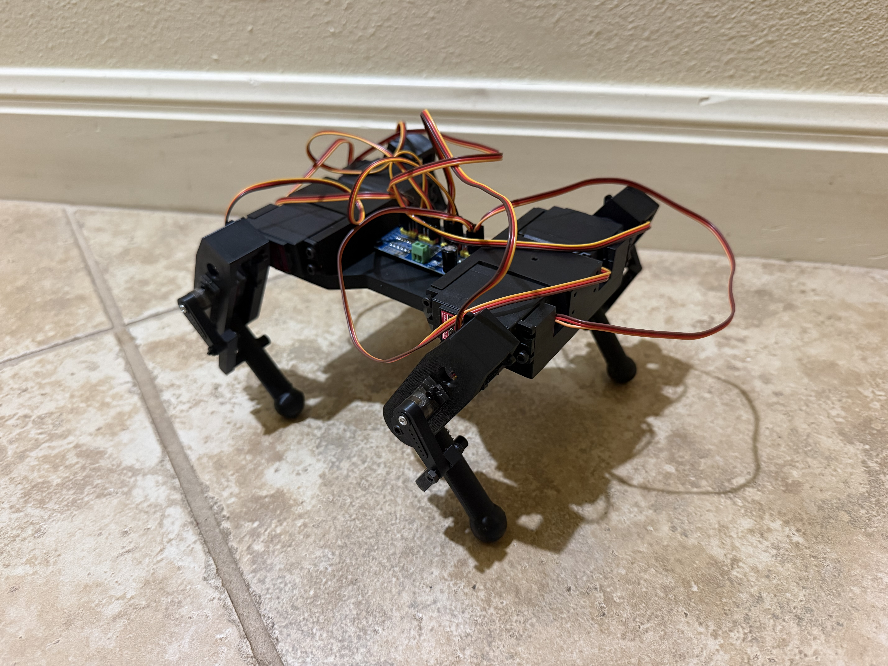

# RobotPiDog

A Raspberry Pi robot dog project with CAD models, firmware, and a parts list.

## Pictures

### Robot dog — isometric view

### CAD overview

Image files are stored in [`IMAGES/`](IMAGES/).

## Project files

- [`cad/`](cad/): SolidWorks models and exported parts.
- [`firmware/`](firmware/): Robot control code.
- [Bill of materials](Robot%20Dog-bom.csv): Parts list.

## License

[MIT](LICENSE)
